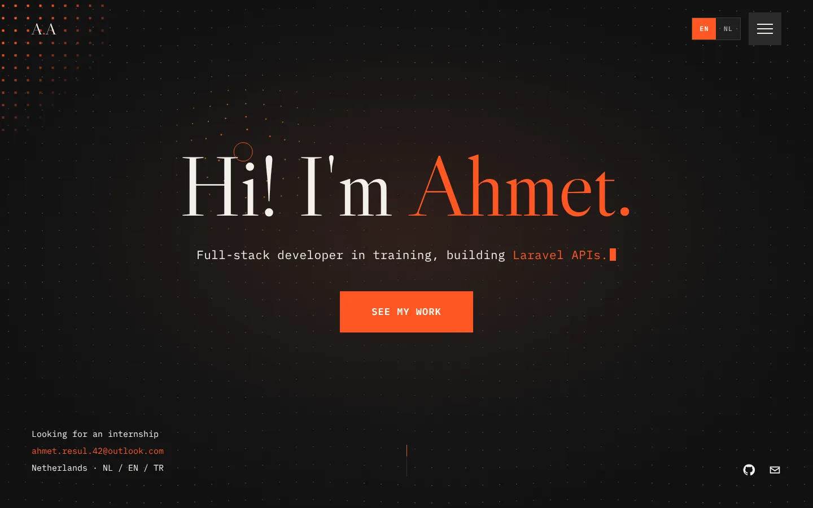
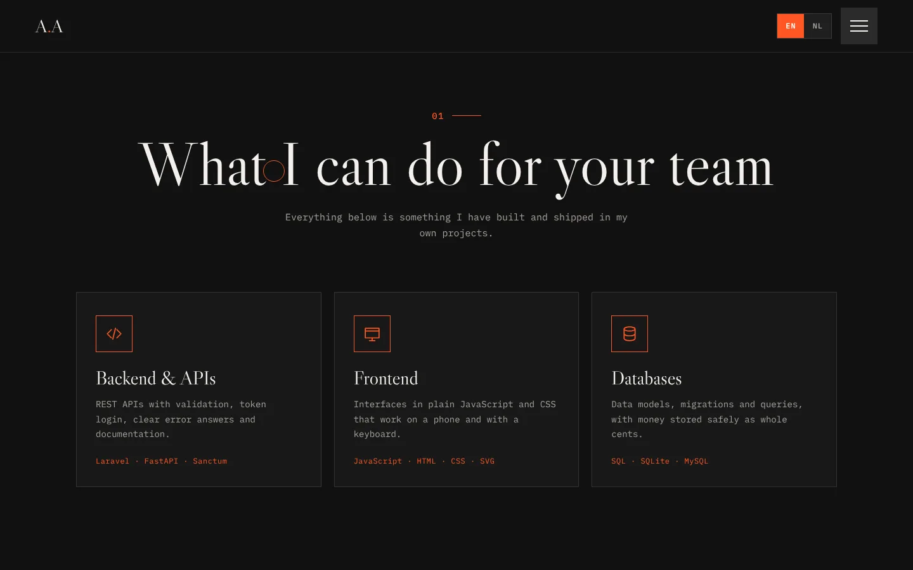
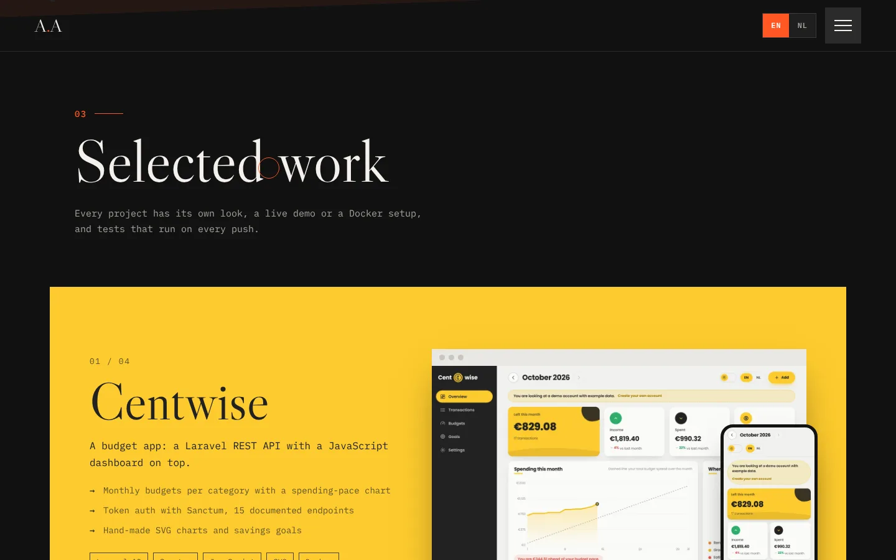

# Ahmet Akbulut · Portfolio

My personal website: who I am, what I can do for a team and the projects I have built. It is a static site with no framework and no build step, hosted on GitHub Pages.

**Live:** [ahmetr42.github.io/portfolio](https://ahmetr42.github.io/portfolio/)



| What I do | Selected work |
| --- | --- |
|  |  |

## What's on the page

- **Hero** with a field of dots on a canvas that moves like water and moves away from the mouse, letters that rise one by one and a line that types out what I build.
- **What I do**: six cards for backend, frontend, databases, testing, Docker and two languages.
- **About me** with counters in animated rings.
- **Selected work**: Centwise, FitHelper, ApplyTrack and Kanban Board. Each card has the colours of its own project and stacks over the previous one while you scroll.
- **Contact** form that opens your mail app with the message filled in, since the site has no server.
- A full-screen menu that opens in a circle from the menu button.
- An **EN/NL switch** with a sliding block and an orange wipe over the page. The choice is remembered.
- Respects "reduce motion" in the operating system: animations are turned off, and the page stays complete.

## Built with

HTML, CSS and plain JavaScript modules. Fonts: Libre Caslon and IBM Plex Mono.

```
index.html            The page
assets/css/style.css  All styling and animations
assets/js/main.js     Loader, menu, language switch, canvas background, scroll and mouse effects
assets/js/i18n.js     Every text in English and Dutch
assets/img/           Screenshots of the projects
tests/                Checks that both languages have every text
```

## Run it locally

Any static file server works, for example:

```bash
python3 -m http.server 8000
```

Then open http://localhost:8000.

## Tests

```bash
node --test tests/*.test.js
```

GitHub Actions runs them on every push.

## License

MIT
